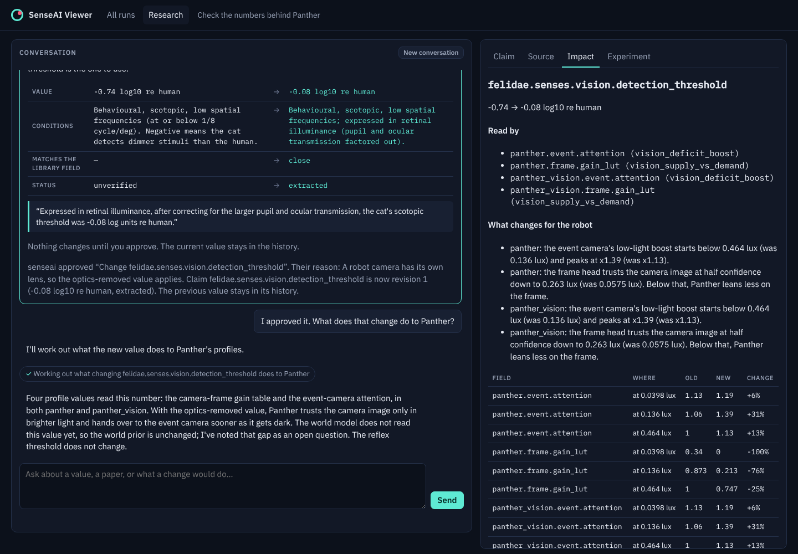

# senseai-research

A place to check the numbers that make Panther a panther.

The species library (`profiles/library/*.yaml`) holds values such as "a cat sees light 0.74 log
units dimmer than a human". Those values set how the robot's camera and reflexes behave at
night. This repository keeps an **evidence ledger** of them: for each value, the paper, the exact
passage it came from, the conditions it was measured under, and every correction anyone has made.
It also runs a chat assistant over that ledger and runs bench experiments on real Zurich night
recordings. A biologist can see where a number came from, correct it in plain language, see what
the correction does to the robot, and sign off on a library change.

The full design is in [`docs/SPEC.md`](docs/SPEC.md).

> **Status: all six phases built.** The `/research` page in the viewer, the curate pipeline
> (`senseai-library`), which now lives here, and the EC2 install below.

## For a researcher

Open **Research** in the viewer (`/research`, behind the viewer password). The left side is the
conversation; the right side shows the value you are looking at.

- **Start screen**: *Open questions* (the research queue, most important first) and
  *Least-verified values Panther depends on*. Click a value to see it in the Claim tab.
- **Ask in plain words**, for example "Where does −0.74 come from, and is it the right number for
  a robot camera?". Each step the assistant takes shows as a small chip ("Fetching the full
  text of 10.1152/jn.90641.2008"). Passages it finds appear in the **Source** tab, with the quote
  highlighted.
- **Changes are cards.** When the assistant proposes a correction, a card shows the old and new
  value and the quote it rests on. Nothing changes until you write your reason and click
  **Approve**. A "yes" in the chat is not an approval. The old value stays in the claim's
  history.
- **Impact** shows which robot settings read the value and what changes, and whether the world
  model reads it. **Experiment** shows bench results on night recordings, with the chance hit
  rate (the luck check) beside every hit rate.



The same assistant also runs in a terminal on the EC2 box:

```bash
senseai-research ask
you> Where does −0.74 come from, and is it the right number for a robot camera?
```

It looks the value up in the ledger, fetches the open-access paper and quotes the passage word
for word. It can propose a correction, work out what the correction does to Panther, run it on
night recordings, and propose the library change. Every proposal shows as a card. Type
`:approve <id> <your reason>` or `:reject <id> <your reason>`; a "yes" in the chat does not count.

Without the assistant, the same ledger is available directly:

```bash
senseai-research claims --status unverified        # the values with no checked quote yet
senseai-research claims --path felidae.senses.vision
```

Each line shows a value's status, its place in the library, and the number with its unit.
`unverified` means nobody has yet found the sentence in a full-text paper that gives this number.

To see what a correction would do before anyone runs anything:

```bash
senseai-research impact --path felidae.senses.vision.detection_threshold --value 0
```

It lists the profile values that read this number. Each change gets one plain sentence, for
example "the frame head trusts the camera image at half confidence down to 0.316 lux (was
0.0575 lux)". A table follows with every changed point, and it says whether the world model reads
the value at all. Every number comes from re-deriving the profiles in code, not from an estimate.

To see what it does on recordings (minutes; the baseline is run once and then reused):

```bash
senseai-research experiment --path felidae.senses.vision.detection_threshold --value 0 \
    --sequences zurich_city_03_a,zurich_city_09_b --arms panther_prior,null_profile
```

The table shows each arm's hit rate before and after, with the **chance hit rate** beside it:
how often the arm would "hit" by luck alone. A hit rate is meaningful only well above its chance
rate. With fewer than 20 labelled objects the table says "too few objects to judge" instead of
a percentage.

### Approving a change

Nothing reaches the ledger or the library until a person approves it with a reason:

```bash
senseai-research pending                         # what is waiting, with the quote it rests on
senseai-research approve act-… --rationale "For a camera the lens replaces the pupil."
senseai-research reject  act-… --rationale "The pupil value is the one we want."
```

Approving a library change opens a pull request on profiles (with `GITHUB_TOKEN` set). Without
a token, the patch and the PR text are saved under `RESEARCH_DATA/outbox/`. The PR lists each
value with its paper and verbatim quote, your reason, the impact table and the experiment
results, and says who approved it and when.

## For an operator

### On the EC2 box (where the viewer runs)

```bash
git clone https://github.com/senseai-institute/research ~/senseai/research-repo
bash ~/senseai/research-repo/scripts/install_research_ec2.sh   # no model is called
research-ctl.sh start                                          # then open /research in the viewer
```

The install reuses what the viewer's `deploy/setup_ec2.sh` set up (`~/senseai/.venv`,
`~/senseai/profiles`, the viewer settings in `~/senseai/viewer.env` or
`/etc/senseai-viewer.env`). It installs senseai-research into that environment, writes
`~/senseai/research.env`, imports the library into the ledger, installs `research-ctl.sh`
(`start | stop | restart | status | logs`), adds `RESEARCH_URL` to the viewer settings and
restarts the viewer if it can. It is safe to run again. Put `ANTHROPIC_API_KEY` (and, for
library PRs on GitHub, `GITHUB_TOKEN`) in `~/senseai/research.env`; `research-ctl.sh status`
says whether the model is reachable. The research server listens on 127.0.0.1 only, so people
reach it through the viewer, behind the viewer password.

### By hand

```bash
uv venv && uv pip install -e "packages/senseai-research[dev]"   # needs read access to profiles
export SENSEAI_PROFILES_REPO=~/senseai/profiles                 # a profiles checkout
export RESEARCH_DATA=~/senseai/research                        # the ledger lives here

senseai-research import                  # library values -> claims; requests -> hypotheses
senseai-research export --out export/    # reviewable YAML, stable byte for byte
senseai-research backup [--s3 s3://bucket/prefix]
senseai-research schema --out schema/    # JSON Schema of every record
```

The research server: `senseai-research serve` (127.0.0.1:`RESEARCH_PORT`, default 8100). The
viewer shows the Research page when `RESEARCH_URL=http://127.0.0.1:8100` is set in its
environment. It proxies `/api/research/*` and passes the signed-in user on.

Experiments need the stack installed the way the viewer's `deploy/setup_ec2.sh` does it
(`~/senseai/.venv`), plus `SENSEAI_DATA_ROOT` (prepared DSEC recordings),
`SENSEAI_BENCH_CMD` and `SENSEAI_BENCH_PYTHON`. Each run happens in a temporary copy of the
profiles checkout, so the checkout itself is never written.

`import` is safe to run again. Values that changed upstream become new revisions; nothing is
overwritten.

### Drafting library entries (`senseai-library`)

The literature pipeline that drafts `library/<clade>.yaml` from papers moved here from profiles
(module `senseai_research.curate`). It reads and writes the profiles checkout in
`SENSEAI_PROFILES_REPO` (or `--root`):

```bash
senseai-library draft felidae          # search, fetch open access, extract with quotes, review sheet
senseai-library approve felidae --reviewer "Name"
```

`senseai_profiles.curate` still works as a deprecated alias.

## Development

```bash
cd packages/senseai-research
ruff check . && ruff format --check . && mypy && pytest -q
```

Tests use no network and no API key. `SENSEAI_PROFILES_REPO` pointing at a full profiles checkout
turns on the test that imports the real library.
